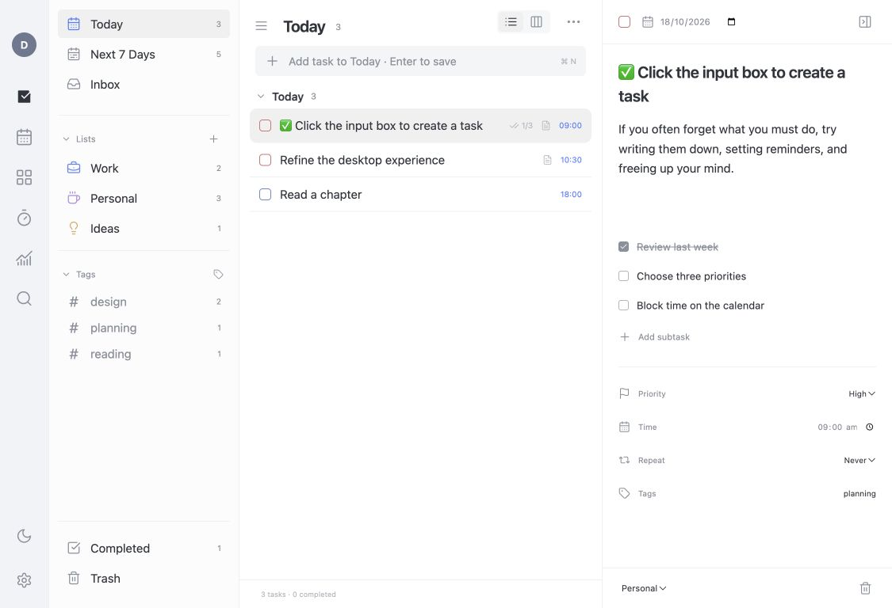

# Daymark

### Reverse engineered from TickTick with REA

**Daymark is a desktop task manager reverse engineered from TickTick’s macOS app and desktop interfaces.** The investigation used [REA — Reverse Engineer Anything](https://github.com/morluto/rea) to inspect the supplied Mac binary, compiled UI resources, native metadata, and asset catalogs. Official Windows screenshots and a static inspection of TickTick’s Windows installer informed the cross-platform reconstruction.

The result is a working Electron + React app with original source code. It reconstructs the observed interface and core task workflows; it is not recovered TickTick source, a compatible TickTick cloud client, or complete feature parity. Daymark is an independent project and is not affiliated with TickTick.


[Download desktop builds](https://github.com/atratheking/daymark/releases/latest) · [Reverse-engineering findings](docs/REVERSE_ENGINEERING.md) · [Validation and limitations](docs/VALIDATION.md)

## What works

- Tasks, custom lists, Today/Tomorrow/Next 7 Days, Completed, and recoverable Trash.
- Notes, subtasks, dates, times, priorities, tags, and moving tasks between lists.
- Daily/weekly/monthly recurrence with duplicate-successor prevention.
- Quick capture: `Read tomorrow #books !2` recognizes a date, tag, and priority.
- Search; date/priority/title sorting; list and Kanban views.
- Month/week calendar with drag-to-date scheduling.
- Eisenhower-style matrix with drag-to-reprioritize.
- Focus timer with pause/reset, short breaks, and completed-session totals.
- Daily habit check-ins, dark/light themes, native menus, and keyboard shortcuts.
- Persistent on-device data and JSON backup export/import.

<details><summary>Light theme</summary>



</details>

## Download and run

Grab the ZIP for your platform from [GitHub Releases](https://github.com/atratheking/daymark/releases/latest):

- **macOS Apple Silicon:** extract the archive and open `Daymark.app`.
- **Windows x64:** extract the entire archive, then run `Daymark.exe`. Keep the accompanying files together.

These are unsigned development builds. The Mac package has been launched and visually inspected. The Windows package has been generated and its executable format checked, but has not been run on Windows. Intel Mac and Windows ARM builds are not supplied.

## Develop

Use Node.js 24+ and npm. Dependencies are locked in `package-lock.json`.

```sh
npm ci
npm run dev
```

```sh
npm test
npm run desktop
npm run package:mac
npm run package:win
```

`desktop` builds the renderer and launches Electron. Packaging downloads official Electron runtimes and writes desktop directories/ZIPs to `releases/`. Use `npm run dev -- --port 5189` if the default port is occupied.

Shortcuts: Cmd/Ctrl+N adds a task; Cmd/Ctrl+K searches. The native View menu provides Cmd/Ctrl+1/2/3/4/5 for Today, Next 7 Days, Inbox, All Tasks, and Tomorrow. All Tasks and Tomorrow are also available in View options.

Tasks live in the app’s user-data profile. Export a backup before moving computers or replacing profiles. The Daymark rename retains the earlier internal storage key/profile for compatibility. Browser preview uses a separate profile. Included example tasks are synthetic.

The desktop renderer is sandboxed, with context isolation and no Node integration. Its shell blocks remote network requests, external navigation, popups, and permission requests.

## Reverse-engineering scope

The **macOS investigation** identified TickTick 8.2.30 (build 923), universal Intel/Apple Silicon binaries, decoded 64 compiled UI documents, inspected 355 Objective-C class/metaclass records within a bounded metadata scan, and inventoried five asset catalogs. Native screenshots supplied the visual comparison baseline.

The **Windows investigation** used seven official desktop reference images and static PE-resource inspection of the official installer. It did not execute or decompile the installed Windows application.

See [the investigation report](docs/REVERSE_ENGINEERING.md) for methods, provenance, visual comparison results, and unresolved questions. Original TickTick executables, private account screenshots, personal task data, and raw local analysis artifacts are excluded from this public repository and its release packages.

## Current limitations

Cloud synchronization, accounts, shared lists, attachments, system reminders, subscribed calendars, full hourly calendar timelines, widgets, sticky-note windows, AI summaries, and premium behavior are not implemented. Week view is a seven-day task grid. Matrix quadrants map to priority rather than recovered urgency rules. Active focus timers do not survive quitting.

The task workspace closely follows the reference’s pane structure and sampled dark colors, but exact icons, native controls, attachment regions, every module/state, and Windows runtime are not visually identical or fully verified.

## Credits

- [TickTick](https://www.ticktick.com/): the original product and reverse-engineering reference. TickTick names and original assets belong to their respective owners.
- [REA by morluto](https://github.com/morluto/rea): the local reverse-engineering toolkit used for the investigation.
- [Electron](https://www.electronjs.org/), [React](https://react.dev/), [Vite](https://vite.dev/), and [Lucide](https://lucide.dev/): application runtime, UI, tooling, and icons.
