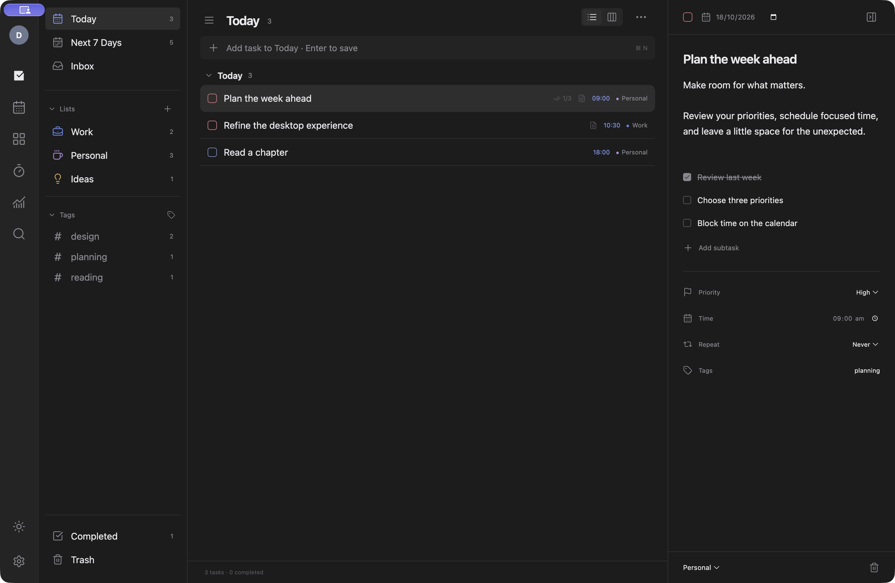

# Reverse engineering TickTick into Daymark

Daymark was reverse engineered from TickTick’s shipped macOS application, its observed desktop UI, official Windows images, and the official Windows installer’s PE resources. The reconstruction implements original task logic and an original Electron/React renderer. No proprietary source was recovered or included.

## Tools and target identity

Used [REA](https://github.com/morluto/rea) 6.5.0, commit `47d3c6b1a15c166091b47666c9cac6dbd882454c`, built from the repository and called through its CLI. No deep disassembly engine was installed or used.

The supplied Mac bundle declares TickTick **8.2.30, build 923**, bundle identifier `com.TickTick.task.mac`, and minimum macOS 12.0. The Mach-O executable contains **x86_64 and arm64** slices. Executable SHA-256: `b1ff12984bf1af78cefdcf638bd4f3b17a16ed36c2ef0d721e2dd5555c914a7e`.

The Windows installer was obtained through the [official Windows download page](https://www.ticktick.com/windows), whose 64-bit link resolved to [tick_win_setup_release_x64_8215.exe](https://download.ticktick.app/download/win64/tick_win_setup_release_x64_8215.exe). SHA-256: `a1be5b73880950d6af015f976f1e65bb065e1970fb702aa885edcfa0f4112fcf`; size: 23,961,968 bytes. The installer stub is PE32 x86; that observation does not establish the architecture of its compressed application payload. A bounded strings scan found an Inno Setup 6.7.0 data marker. The installer was not executed and its payload was not unpacked.

## Evidence collected

| REA operation | Observation | Limit |
| --- | --- | --- |
| `inspect-plist` | Version, bundle identity, supported platform, URL schemes and app-intent declarations | Declarations do not prove runtime behavior. |
| `inspect-macho` | Universal architectures, selected arm64 slice, load/dependency metadata | No recovered function bodies. |
| `decode-interface-builder` | 64 compiled UI documents, 3,994 graph nodes, 1,878 edges | Stopped at the document cap; private/unrecognized fields remain unknown. |
| `inspect-native-dispatch-metadata` | 355 Objective-C class/metaclass records, including task-detail, calendar, habit and focus-related names | 10,000-record budget, unresolved ivar offsets, partial/unsupported Swift facets. |
| `inspect-asset-catalog` | Five catalogs reporting 3,949 records | Saved page returned the first 1,000 records. No original catalog artwork was shipped. |
| `inspect-pe-resources` | Windows installer resource tree, offsets, payload hashes and icon-group relationships | Installer-only evidence, not installed-app internals. |

The original bundle was not patched, re-signed or repackaged. Raw analysis files remain outside the public repository because they contain local machine paths and full vendor metadata. Personal account screenshots and original vendor binaries are also excluded.

## Visual reconstruction

Native macOS screenshots established a narrow module rail, navigation column, grouped task list, and persistent right detail editor. Seven images linked from the [official Windows page](https://www.ticktick.com/windows) informed the light theme and other desktop workflows. Those marketing images do not establish exact current runtime dimensions or implementation details.

Daymark was compared at **1125 × 768 logical pixels** against the Mac reference at **2250 × 1536 physical pixels**. Final pane widths are **62 / 240 / 457 / 366 px**. Navigation/task and task/detail boundaries lie within approximately one logical pixel of the visually measured reference. The first selected row starts at y=137 versus approximately y=138 in the reference.

Sampled blank-region colors match: rail RGB 36/36/36; navigation, task pane, and detail pane RGB 28/28/28; quick input RGB 35/35/35. These are specific structural/color observations, not a whole-image similarity score. Adjustments also covered header/input placement, row density, typography, selected-row shape and content-sized editor titles.



Task content, custom lists/tags, avatar, module icons, date/time controls, footer controls, and the original attachment area differ. Full visual parity is not established across every module, state or platform. Public screenshots show Daymark with synthetic test data; original private reference captures are not distributed.

## What was inferred or newly implemented

The original source, persistence format, task algorithms and sync protocol were not recovered. Daymark’s storage schema, recurrence handling, calendar layout, priority-mapped matrix, quick-capture parser, sample data, CSS measurements and generic icons are original implementation choices informed by the observed product.

The build has no TickTick login, cloud compatibility, subscription mechanism or premium bypass. It does not use TickTick’s private services.

## Reproducing the static investigation

Use your own authorized copy of the target app with the REA checkout:

```sh
node scripts/rea.mjs inspect-plist /path/to/TickTick.app/Contents/Info.plist --json
node scripts/rea.mjs inspect-macho /path/to/TickTick.app --json
node scripts/rea.mjs decode-interface-builder /path/to/TickTick.app --json
node scripts/rea.mjs inspect-native-dispatch-metadata /path/to/TickTick.app --max-records 10000 --json
node scripts/rea.mjs inspect-asset-catalog /path/to/TickTick.app --json
node scripts/rea.mjs inspect-pe-resources /path/to/tick_win_setup_release_x64_8215.exe --max-file-bytes 536870912 --json
```

## Open questions

Windows installed-app internals and runtime; native algorithms; original database schema; synchronization and authentication protocols; premium feature implementation; detailed timeline behavior; exact native controls, accessibility and animations. None is established by this reconstruction.
